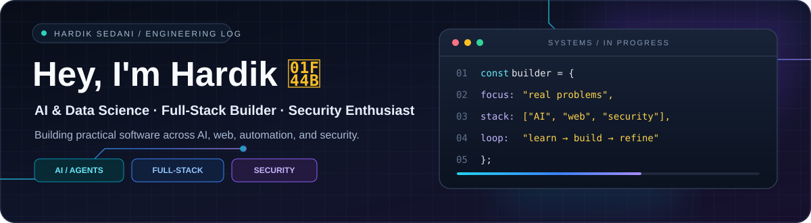
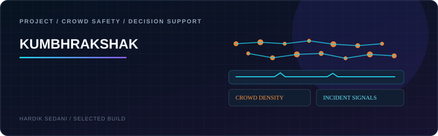
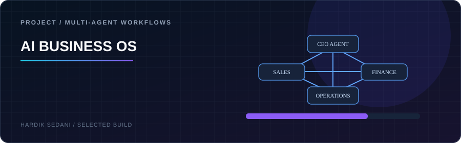
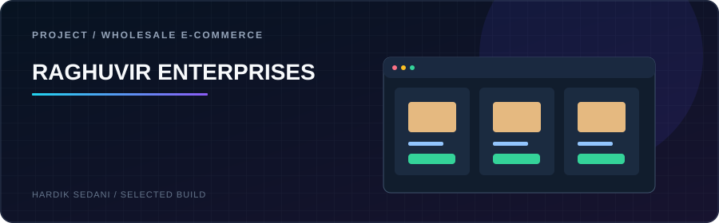
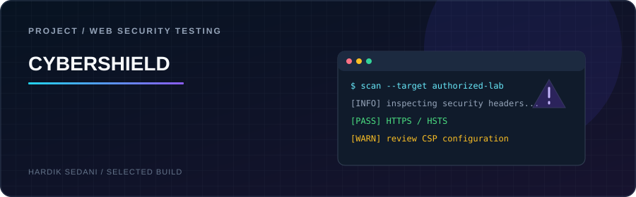

<!--
HARDIK SEDANI — GitHub profile README
Repository must be named exactly: hardiksedani
Keep all assets in the /assets folder. Verify external demo URLs before publishing.
-->

  

  
  
  
  

  <b>AI & Data Science @ K. J. Somaiya Institute of Technology</b> 
  Full-Stack Engineering &nbsp;·&nbsp; AI Systems &nbsp;·&nbsp; Workflow Automation &nbsp;·&nbsp; Application Security

  <a href="#-featured-builds">Featured builds</a> &nbsp;·&nbsp;
  <a href="#-tech-stack">Tech stack</a> &nbsp;·&nbsp;
  <a href="#-experience--community">Experience</a> &nbsp;·&nbsp;
  <a href="#-currently-exploring">Currently exploring</a>

---

## ✦ `01` — WHAT I'M ABOUT

<table>
  <tr>
    <td width="25%" valign="top">
      <h3>🎓 Engineer in progress</h3>
      B.Tech in Artificial Intelligence & Data Science at K. J. Somaiya Institute of Technology.
    </td>
    <td width="25%" valign="top">
      <h3>⌘ Product builder</h3>
      I build end-to-end apps across the UI, backend, data layer, APIs, and deployment.
    </td>
    <td width="25%" valign="top">
      <h3>◈ AI & automation</h3>
      I explore AI agents, API integrations, event-driven workflows, and human-in-the-loop automation.
    </td>
    <td width="25%" valign="top">
      <h3>⛨ Security-minded</h3>
      I am building skills in web security testing, secure backend patterns, and ethical penetration testing.
    </td>
  </tr>
</table>

> **My approach:** Build for a real use case. Make the system understandable. Test the important paths. Document what is live and what is still in progress.

## 🚀 FEATURED BUILDS

<table>
  <tr>
    <td width="50%" valign="top">
      
      <h3>🛰️ KumbhRakshak</h3>
      <b>AI-assisted crowd safety & decision support</b>
      
A Mahakumbh-focused concept for bringing crowd signals, incident awareness, and operator decision support into one place. For hackathon demos, keep a clear distinction between live data and simulated inputs.

      
<code>AI</code> <code>Computer Vision</code> <code>IoT concepts</code> <code>Web</code>

      

      Source repository: publish or confirm the public repository URL before adding a source-code button.
    </td>
    <td width="50%" valign="top">
      
      <h3>🧠 AI Business OS</h3>
      <b>Multi-agent business workflow platform</b>
      
A business operating-system concept where a CEO agent coordinates specialist agents across marketing, sales, finance, development, support, HR, and operations.

      
<code>Next.js</code> <code>TypeScript</code> <code>Supabase</code> <code>PostgreSQL</code> <code>n8n</code>

      

    </td>
  </tr>
  <tr>
    <td width="50%" valign="top">
      
      <h3>🛒 Raghuvir Enterprises</h3>
      <b>Live e-commerce product for a wholesale business</b>
      
A deployed product catalogue and ordering experience for a family-run wholesale business, with product discovery, cart, account flows, and payment integration.

      
<code>Next.js</code> <code>React</code> <code>Tailwind CSS</code> <code>Supabase</code> <code>Razorpay</code>

      

    </td>
    <td width="50%" valign="top">
      
      <h3>🛡️ CyberShield</h3>
      <b>Web security testing & AI-assisted analysis</b>
      
A desktop security tool exploring browser-assisted vulnerability discovery, security-header checks, and AI-supported explanations and remediation guidance.

      
<code>Electron</code> <code>React</code> <code>Puppeteer</code> <code>Gemini</code>

      

    </td>
  </tr>
</table>

## 🧩 MORE BUILDS & EXPERIMENTS

<table>
  <tr>
    <td width="50%" valign="top">
      <h3>◉ Lumen — AI Website Builder</h3>
      Prompt-driven website generation, iteration, and code-export workflows.
        
      <a href="https://websitebuilder.neuraxine.com/">Open demo ↗</a>
    </td>
    <td width="50%" valign="top">
      <h3>◉ WhatsApp Automation Platform</h3>
      Business messaging workflows connected through webhooks, n8n, and Supabase.
        
      <a href="https://whatsappautomations.vercel.app/">Open demo ↗</a>
    </td>
  </tr>
  <tr>
    <td width="50%" valign="top">
      <h3>◉ LeadFinder</h3>
      Lead research / prospect workflow project. Review the repository for the current feature set.
        
      <a href="https://github.com/hardiksedani/lead-scrapperrr">Inspect repository ↗</a>
    </td>
    <td width="50%" valign="top">
      <h3>◉ Canteen Management System</h3>
      Role-based canteen ordering with student, staff, and manager workflows; Flask REST API and MySQL.
        
      <a href="https://github.com/hardiksedani/CANTEEN_MANAGEMENT_SYSTEM">Inspect repository ↗</a>
    </td>
  </tr>
</table>

  
<b>More projects I am exploring</b>

   

  - **SafeURL Scanner** — website URL safety analysis using VirusTotal and related security feeds. Add the source link once the intended public repository is confirmed.
  - **Smart Health Pet Monitoring System** — in progress: exploring motion sensing, GNSS/cellular connectivity, and cloud data ingestion. This is a learning/build-in-progress project, not claimed as production-ready.
  - **Automobile Inventory Management System** — repository available on my profile; add a detailed, project-specific README and screenshots before featuring it prominently.

## 🧰 TECH STACK

  

<table>
  <tr><td><b>Languages</b></td><td>Python · Java · C · JavaScript · TypeScript · SQL</td></tr>
  <tr><td><b>Frontend</b></td><td>React · Next.js · HTML · CSS · Tailwind CSS</td></tr>
  <tr><td><b>Backend & data</b></td><td>Node.js · Flask · REST APIs · PostgreSQL · Supabase · MySQL</td></tr>
  <tr><td><b>AI & automation</b></td><td>OpenAI API · Google Gemini API · n8n · Webhooks · Multi-agent systems</td></tr>
  <tr><td><b>Security & systems</b></td><td>Web security testing · Authentication · Row Level Security · Computer networks · Linux</td></tr>
  <tr><td><b>Build & deploy</b></td><td>Git · GitHub · VS Code · Vercel</td></tr>
</table>

## 💼 EXPERIENCE & COMMUNITY

**AI & Automation Intern — Neuraxine AI** · *June–August 2026*

- Developed full-stack applications with Next.js, React, Node.js, Supabase, and PostgreSQL.
- Worked with authentication, Row Level Security, AI API integration, n8n, and webhook-driven automation.
- Deployed web applications with Vercel and connected application workflows across services.

**Marketing Head — S4DS, K. J. Somaiya Institute of Technology** · *July 2026–present*

- Contribute to hackathon marketing, outreach, promotional content, and student technology events.
- Helped promote a 36-hour hackathon and participate in data-science community activities.

## 📊 GITHUB ACTIVITY

  
  

  

If a third-party stats image is temporarily unavailable, the profile still works; GitHub's native contribution calendar is shown on the profile page below the README.

## 🔭 CURRENTLY EXPLORING

- [ ] **System design:** cleaner boundaries, reliable APIs, and scalable architecture.
- [ ] **Agentic workflows:** orchestration, observability, retries, and human approval.
- [ ] **Application security:** authorized testing, threat modeling, and secure-by-default backend patterns.
- [ ] **IoT systems:** sensor data collection and reliable cloud connectivity.

## 🧠 THE MINDSET

<table>
  <tr>
    <td align="center" width="33%"><h3>Build useful things.</h3>Start from a real problem.</td>
    <td align="center" width="33%"><h3>Learn deeply.</h3>Understand the system, not only the UI.</td>
    <td align="center" width="33%"><h3>Secure what you build.</h3>Ship with evidence and responsibility.</td>
  </tr>
</table>

  <b>Build with intent. Ship with evidence. Secure by design.</b> 
  Thanks for visiting. Explore a repository, review the architecture, and share an idea.

