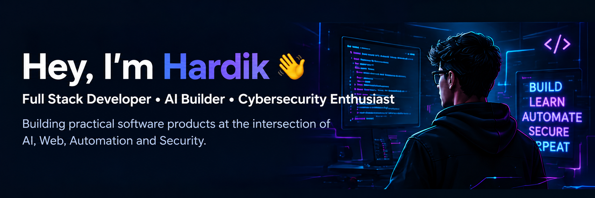
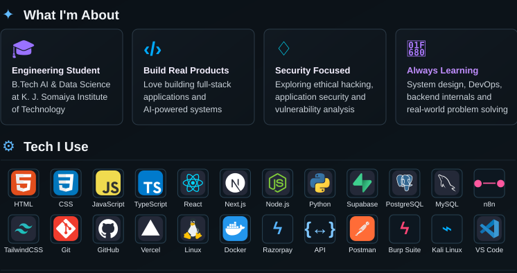
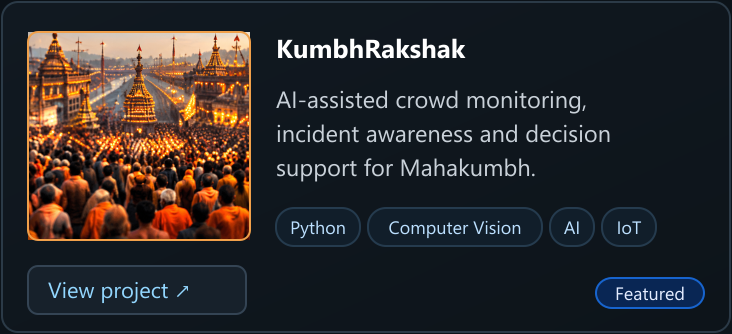
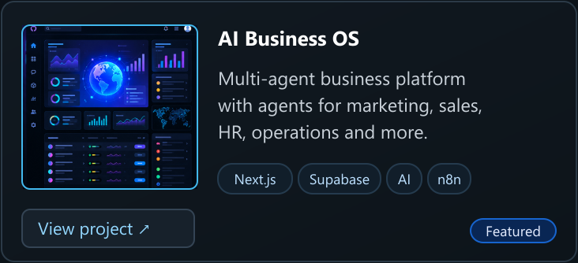
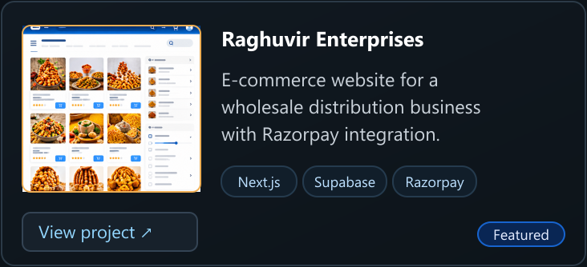
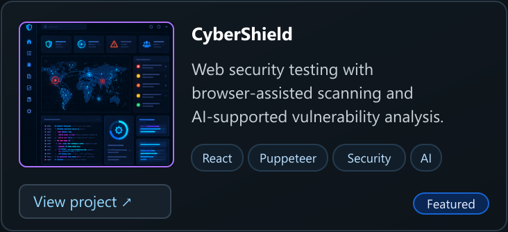
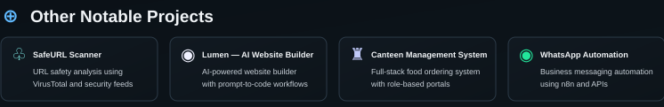
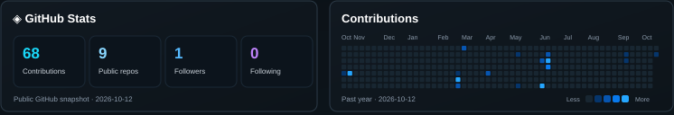
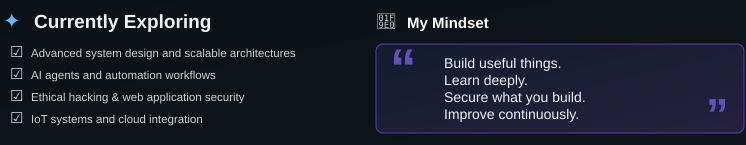

<!-- Profile repository: hardiksedani/hardiksedani. Upload assets/ alongside this file. -->

  

  &nbsp;
  &nbsp;
  &nbsp;
  

  
  

  
  

  <a href="https://websitebuilder.neuraxine.com/">Lumen ↗</a> &nbsp; · &nbsp;
  <a href="https://github.com/hardiksedani/CANTEEN_MANAGEMENT_SYSTEM">Canteen Management ↗</a> &nbsp; · &nbsp;
  <a href="https://whatsappautomations.vercel.app/">WhatsApp Automation ↗</a>

Profile text, project links &amp; experience

### Hey, I'm Hardik 👋

Full Stack Developer • AI Builder • Cybersecurity Enthusiast

Building practical software products at the intersection of AI, Web, Automation and Security.

### What I'm About

- **Engineering Student:** B.Tech in Artificial Intelligence & Data Science at K. J. Somaiya Institute of Technology.
- **Build Real Products:** Full-stack applications, APIs, data layers, and AI-powered systems.
- **Security Focused:** Exploring ethical hacking, application security, secure backend patterns, and vulnerability analysis.
- **Always Learning:** System design, DevOps, backend internals, and real-world problem solving.

### Tech I Use

HTML · CSS · JavaScript · TypeScript · React · Next.js · Node.js · Python · Supabase · PostgreSQL · MySQL · n8n · Tailwind CSS · Git · GitHub · Vercel · Linux · Docker · Razorpay · APIs · Postman · Burp Suite · Kali Linux · VS Code.

Also exploring Java, C, Flask, SQL, OpenAI and Gemini APIs, webhooks, authentication, Row Level Security, and computer networks. Security tools are part of my learning stack.

### Featured Projects

Project thumbnails are decorative artwork; follow the links to see the actual applications.

- **[KumbhRakshak](https://mahakumbhprojects.vercel.app/)** — AI-assisted crowd safety and decision support for Mahakumbh. A concept bringing crowd signals, incident awareness, and operator decision support together; demos may include simulated inputs.
- **[AI Business OS](https://multiagentscursors.vercel.app/)** — A business operating-system concept where a CEO agent coordinates specialist agents across marketing, sales, finance, development, support, HR, and operations.
- **[Raghuvir Enterprises](https://www.raghuvirenterprises.in/)** — Product catalogue and ordering experience for a family-run wholesale business, with product discovery, cart, account flows, and payment integration.
- **[CyberShield — source code](https://github.com/hardiksedani/CYBERSHEILD)** — Desktop security tool exploring browser-assisted vulnerability discovery, security-header checks, and AI-supported explanations and remediation guidance. Built with Electron, React, Puppeteer, and Gemini.

### Other Projects

- **SafeURL Scanner** — URL safety analysis using VirusTotal and related security feeds.
- **[Lumen — AI Website Builder](https://websitebuilder.neuraxine.com/)** — Prompt-driven website generation, iteration, and code-export workflows.
- **[Canteen Management System](https://github.com/hardiksedani/CANTEEN_MANAGEMENT_SYSTEM)** — Role-based ordering with student, staff, and manager workflows; Flask REST API and MySQL.
- **[WhatsApp Automation](https://whatsappautomations.vercel.app/)** — Business messaging workflows connected through webhooks, n8n, and Supabase.
- **[LeadFinder](https://github.com/hardiksedani/lead-scrapperrr)** — Lead research and prospect workflow project.
- **Smart Health Pet Monitoring System** — In progress: motion sensing, GNSS/cellular connectivity, and cloud data ingestion.
- **Automobile Inventory Management System** — An additional project on my GitHub profile.

### Experience & Community

**AI & Automation Intern — Neuraxine AI** · June–August 2026

- Developed full-stack applications with Next.js, React, Node.js, Supabase, and PostgreSQL.
- Worked with authentication, Row Level Security, AI API integration, n8n, and webhook-driven automation.
- Deployed web applications with Vercel and connected application workflows across services.

**Marketing Head — S4DS, K. J. Somaiya Institute of Technology** · July 2026–present

- Contribute to hackathon marketing, outreach, promotional content, and student technology events.
- Helped promote a 36-hour hackathon and participate in data-science community activities.

### Currently Exploring

- Advanced system design and scalable architectures.
- AI agents and automation workflows.
- Ethical hacking and web application security.
- IoT systems and cloud integration.

**Build useful things. Learn deeply. Secure what you build. Improve continuously.**

[LinkedIn](https://in.linkedin.com/in/hardik-sedani-063a90355) · [Email](mailto:hardiksedani2610@gmail.com) · [All repositories](https://github.com/hardiksedani?tab=repositories)

